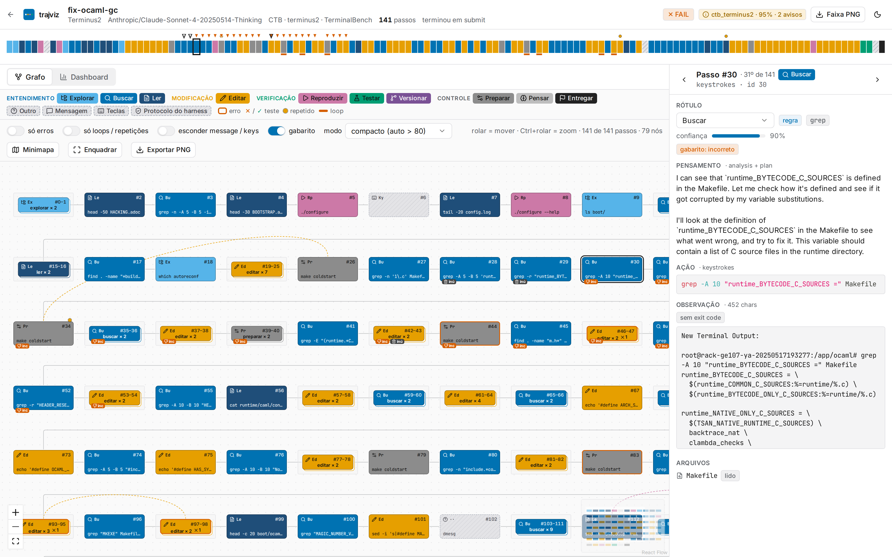

# trajviz

Visualizador de trajetórias de agentes de código **sem rotulação manual**. Você envia o log bruto de um agente (OpenHands, SWE-agent, mini-SWE, Terminus2, Ark, Claude Code ou chat genérico) e vê na hora a faixa de fases, o grafo da trajetória, o inspetor de cada passo e um dashboard com detectores de erro, repetição e loop.
O problema que resolve: entender onde um agente se perdeu exige ler centenas de passos, e a ferramenta de referência (TraceView) pede que cada ação e cada relação sejam rotuladas à mão antes de mostrar qualquer coisa. No trajviz, uma rotulação em camadas (regras, com fallback opcional em LLM) rotula cada passo no upload.

TCC I — DCC/UFMG · Pedro Henrique Egito Aguiar · Orientador: Marco Túlio Valente



*Faixa de fases (topo), grafo em serpentina com modo compacto, marcadores do gabarito do CodeTraceBench e inspetor do passo à direita.*


## Diferenciais frente ao TraceView

| | TraceView | trajviz |
|---|---|---|
| Rotulação | manual: 44 rótulos (8 passos) a 158 (27 passos) para a visualização completa | **automática: 0 rótulos**; correção opcional por passo |
| Formatos | SWE-agent, JSON/JSONL, texto | **10 adaptadores com detecção automática** sobre um modelo canônico |
| Métricas | resumo de relações e tabela de execuções | **dashboard por trajetória** e detectores automáticos |
| Relações semânticas entre passos | **sim** (a contribuição central dele) | não (TCC II) |

Medidas, capturas e ressalvas: [docs/comparacao_traceview.md](docs/comparacao_traceview.md).

## Início rápido

### Docker

```bash
mkdir -p backend/.cache data/samples data/raw/codetracebench   # pastas montadas como volume
docker compose up --build
# web: http://localhost:5173 · API (Swagger): http://localhost:8010/docs
```

- Portas: `WEB_PORT` (padrão 5173) e `API_PORT` (padrão 8010), ex.: `WEB_PORT=8080 API_PORT=8020 docker compose up --build`. O nginx do `web` repassa `/api` para a API, então não há CORS em nenhuma porta.
- Volumes: `data/samples/` (biblioteca), `data/raw/codetracebench/` (opcional, gabarito do CodeTraceBench) e `backend/.cache/` (cache e contador de custo do LLM). Sem amostras a biblioteca fica vazia, mas o upload funciona.
- Para não criar arquivos de root: `LOCAL_UID=$(id -u) LOCAL_GID=$(id -g) docker compose up --build`.

### Modo desenvolvimento

```bash
# a partir da raiz, em dois terminais
cd backend && uv sync && uv run uvicorn app.main:app --reload     # API em http://localhost:8000
cd frontend && npm install && npm run dev                          # web em http://localhost:5173
```

Com portas ocupadas, use as variáveis de ambiente:

| variável | onde | padrão | para quê |
|---|---|---|---|
| `VITE_PORT` | front | `5173` | porta do Vite |
| `VITE_API_URL` | front | `http://localhost:8000` | URL da API (também lida de `frontend/.env.local`) |
| `CORS_ORIGINS` | API | `http://localhost:5173` | origens liberadas, separadas por vírgula |

```bash
# a partir da raiz, em dois terminais
cd backend  && CORS_ORIGINS=http://localhost:5174 uv run uvicorn app.main:app --port 8010
cd frontend && VITE_PORT=5174 VITE_API_URL=http://localhost:8010 npm run dev
```

**LLM (opcional).** Sem `backend/.env` o app usa só regras. Para ligar o fallback: `cp backend/.env.example backend/.env` e preencha `ANTHROPIC_API_KEY`, `LABEL_LLM_ENABLED=1`, `LLM_MODEL` (padrão `claude-haiku-5-5`) e `LLM_BUDGET_USD` (padrão 0,50 por execução). A API só chama o LLM quando o upload pede (`use_llm=true`); a chave nunca é impressa nem versionada.

**Uso.** Arraste um arquivo na página inicial ou abra uma amostra da biblioteca. Links abrem direto num passo: `/t/<id>?step=42&view=graph&filter=error` (`view=graph|dashboard`, `filter=error,loop,nospecial,cat:edit`, `range=10-30`, `compact=0|1`, `gt=0`). Teclas: `j`/`k` ou ← → navegam, `Esc` limpa a seleção.

## Formatos suportados

Upload de `.json`, `.jsonl`, `.traj`, `.log`, `.txt`, `.parquet` (uma linha, `row`), `.tar.zst` e `.zip`, até 200 MB. Detecção automática; detalhes em [docs/formats.md](docs/formats.md).

| formato | origem | adaptador | observações |
|---|---|---|---|
| OpenHands (lista de mensagens) | SWE-rebench | `openhands_chat` | `resolved` e `exit_status` da fonte; exit code no texto |
| SWE-agent nativo, xml e ticks | SWE-smith | `sweagent_smith` | ação decidida por mensagem (o split `tool` mistura formatos); `resolved` **não validado** |
| SWE-agent `.traj` | CodeTraceBench, TraceView | `ctb_sweagent` | abre também as amostras do TraceView |
| mini-SWE-agent `.traj.json` | CodeTraceBench | `ctb_miniswe` | 2 de 60 artefatos sem JSON → `UnsupportedArtifact` |
| Terminus2 (episódios) | CodeTraceBench | `ctb_terminus2` | 1 passo por episódio |
| OpenHands (log de chamadas LLM) | CodeTraceBench / SWE-bench | `ctb_openhands_swe` | alinhamento do gabarito por hipótese |
| OpenHands (eventos) | CodeTraceBench / TerminalBench | `ctb_openhands_events` | alinhamento da cauda por hipótese |
| Sessão do Claude Code (`.jsonl`) | `~/.claude/projects/` | `claude_code_session` | 1 passo por `tool_use`; fixture sintética |
| Trace do Ark (`agent_trace.log`) | [Ark](https://github.com/mtov/ark) | `ark_trace` | o Ark **não registra** a saída de leituras, buscas e testes que passaram (o inspetor avisa) |
| Chat genérico OpenAI/Anthropic | qualquer | `generic_chat` | só testado com mensagens sintéticas; agente "desconhecido" |

Artefatos do CodeTraceBench (`.tar.zst` ou diretório) trazem o **gabarito** (passos incorretos e inúteis) a partir do manifest em `data/raw/codetracebench/`.

## Funcionalidades

- **Faixa de fases:** um segmento por passo, colorido pela categoria (paleta segura para daltonismo), com marcas de erro, teste e loop.
- **Grafo em serpentina:** ordem cronológica, modo compacto para trajetórias longas, filtros, minimapa, exportação PNG.
- **Inspetor:** rótulo (corrigível), flags com motivo e link para o passo relacionado, pensamento, ação, observação, arquivos.
- **Dashboard:** desfecho, esforço por categoria e fase, ferramentas e executáveis, 1ª edição, ciclos editar → testar, problemas clicáveis, arquivos lidos × editados, tamanho das observações.
- **Detectores:** `error`, `test_fail`/`test_pass`, `repeated`, `no_new_info`, `loop`, `truncated` ([docs/ROTULACAO_E_DETECTORES.md](docs/ROTULACAO_E_DETECTORES.md)).
- **Gabarito do CodeTraceBench:** passos anotados como incorretos/inúteis marcados no grafo e comparados com as flags.
- **Biblioteca:** 185 amostras (SWE-rebench, SWE-smith, CodeTraceBench, Ark) com filtros e busca.

## Resultados principais

Metodologia, intervalos e ressalvas em [docs/AVALIACAO.md](docs/AVALIACAO.md); relatórios brutos em [results/RESULTS.md](results/RESULTS.md).

- **Rotulação:** regras com acurácia de **94,3%** [IC 95% 90,5–97,4] e F1 macro 0,92 contra um gold manual cego de 210 passos, 1 anotador (`results/eval_classifier.md`, linha 102). Haiku 5.5 em todos os passos: 91,4%. O gold saiu das amostras usadas para escrever as regras; o gold held-out ainda não foi rotulado.
- **Cobertura:** 97,4% a 99,8% dos passos rotulados só por regras (`results/labeling_report.md`, linhas 11–18); custo total do LLM no projeto: **US$ 0,0320** (`backend/.cache/llm_usage.json`).
- **Detectores × gabarito do CodeTraceBench** (976 trajetórias): `error ∪ test_fail` fica 1,62× acima do acaso para passos incorretos [1,44–1,80]; `repeated ∪ no_new_info` é indistinguível do acaso para passos inúteis (0,80×) (`results/eval_detectors.md`, linhas 34 e 49).
- **Resolvidas × não resolvidas** (SWE-rebench, 2.000): as resolvidas são menores (mediana 56 × 68 passos, δ de Cliff −0,34) e têm mais passos de teste (12,8% × 10,7%); associação, não causa (`results/batch_stats.md`, linhas 28 e 33).
- **Velocidade:** pipeline com mediana de 34 ms por trajetória (p95 89 ms; `results/batch_stats.md`, linha 18); do upload ao grafo, ~0,85 s.
- **TraceView:** 0 rótulos manuais × 44–158 para a mesma visualização completa ([docs/comparacao_traceview.md](docs/comparacao_traceview.md)).

## Limitações

Sem relações semânticas entre passos; rótulos automáticos com gold de um anotador e held-out pendente; detectores fracos contra o gabarito do CodeTraceBench (`loop` conservador); `resolved` do SWE-smith não validado; o Ark não registra várias observações e só há traces com Haiku 5.5 (o Sonnet 5.5 foi recusado pela API); sem estudo com usuários. Lista completa e problemas conhecidos da interface em [docs/LIMITACOES_E_TRABALHOS_FUTUROS.md](docs/LIMITACOES_E_TRABALHOS_FUTUROS.md).

## Testes

```bash
# a partir da raiz
cd backend  && uv run pytest            # 468 testes, fixtures reais
cd frontend && npm test                 # vitest (13)
cd frontend && npm run test:e2e         # Playwright (14); sobe API e front com cache isolado
cd frontend && npm run screenshots      # results/screenshots/*.png (amostras em e2e/showcase.json)
```

Os e2e usam `VITE_PORT` e `VITE_API_URL` (padrão: front 5173, API 8011).

## Estrutura do repositório

```
backend/    app/ (schema, adapters, labeling, analysis, pipeline, main) · tests/ · scripts/ (exploração, avaliação, figuras)
frontend/   src/ (api, pages, components, store, theme) · e2e/ (Playwright, capturas, demo)
docs/       documentação (mapa abaixo) · openapi.json · demo.gif
results/    relatórios de avaliação, gold, figuras, capturas, pacote do pôster
data/       raw/ e samples/ (fora do git, exceto os traces do Ark) · inbox/ (não versionado)
prompts/    prompts das fases para o Claude Code
```

## Documentação

| documento | para quê |
|---|---|
| [docs/ARQUITETURA.md](docs/ARQUITETURA.md) | pipeline, módulos, modelo canônico TAR, API, cache, segurança, como adicionar um formato |
| [docs/ROTULACAO_E_DETECTORES.md](docs/ROTULACAO_E_DETECTORES.md) | taxonomia, rotulação em camadas, fallback em LLM, definição de cada detector |
| [docs/AVALIACAO.md](docs/AVALIACAO.md) | metodologia e resultados (gold, gabarito, auditorias, estatística, ameaças à validade) |
| [docs/DADOS.md](docs/DADOS.md) | datasets, download, amostras, achados sobre os dados, traces do Ark |
| [docs/formats.md](docs/formats.md) | formatos brutos campo a campo e assinaturas de detecção |
| [docs/PROCESSO.md](docs/PROCESSO.md) | como o MVP foi construído (fases, IA, papel humano, o que deu errado) |
| [docs/LIMITACOES_E_TRABALHOS_FUTUROS.md](docs/LIMITACOES_E_TRABALHOS_FUTUROS.md) | limitações, problemas conhecidos, TCC II |
| [docs/decisions.md](docs/decisions.md) | registro de decisões por tema |
| [docs/comparacao_traceview.md](docs/comparacao_traceview.md) · [docs/taxonomia_mapeamento.md](docs/taxonomia_mapeamento.md) | comparação com o TraceView e mapeamento de taxonomias |
| [docs/roteiro_demo.md](docs/roteiro_demo.md) | roteiro de 5 minutos para a banca |
| [docs/MAPA_RELATORIO.md](docs/MAPA_RELATORIO.md) | capítulos do relatório e fontes de cada um |
| [docs/GLOSSARIO.md](docs/GLOSSARIO.md) · [docs/PLAN.md](docs/PLAN.md) · [CHANGELOG.md](CHANGELOG.md) | termos, plano original × realizado, versões |

## Créditos

- **Autor:** Pedro Henrique Egito Aguiar · **Orientador:** Marco Túlio Valente · Projeto Orientado em Computação I, DCC/UFMG, 2026.
- **Datasets:** [nebius/SWE-rebench-openhands-trajectories](https://huggingface.co/datasets/nebius/SWE-rebench-openhands-trajectories) (CC-BY-4.0), [SWE-bench/SWE-smith-trajectories](https://huggingface.co/datasets/SWE-bench/SWE-smith-trajectories) (MIT), [NJU-LINK/CodeTraceBench](https://huggingface.co/datasets/NJU-LINK/CodeTraceBench) (MIT); licenças conforme os cards dos datasets.
- **Ark:** agente de código de Marco Túlio Valente (<https://github.com/mtov/ark>, MIT).
- **TraceView:** SOAR-Lab (<https://github.com/SOAR-Lab/agent-traj-visualization>), referência principal; usado como clonado, só para a comparação.
- Código escrito com o Claude Code (Anthropic) a partir de prompts por fase; o papel do autor está em [docs/PROCESSO.md](docs/PROCESSO.md).
