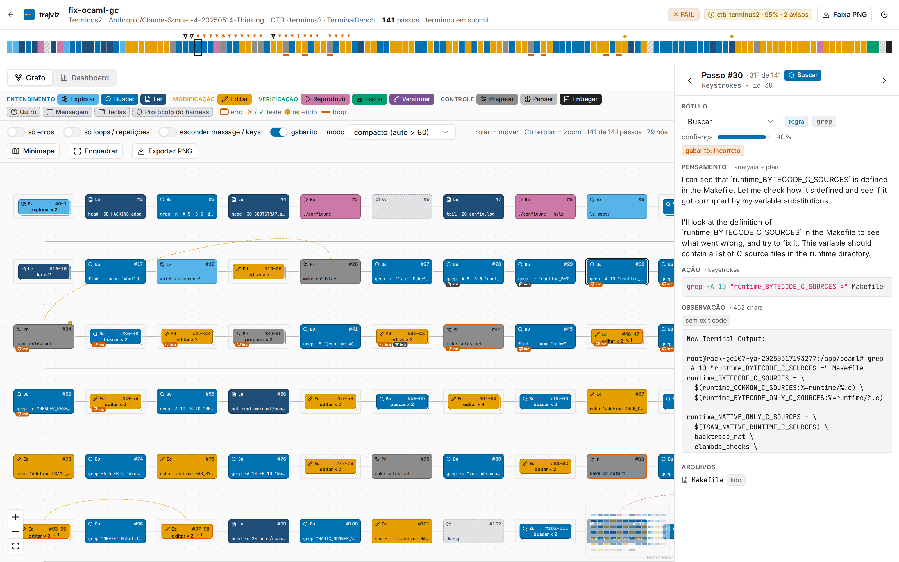

# trajviz

Visualizador de trajetórias de agentes de código. Envie o log bruto de um agente (OpenHands, SWE-agent,
CodeTraceBench ou chat genérico) e veja na hora o grafo da trajetória, a faixa de fases, o inspetor de
cada passo e um dashboard de métricas, sem nenhuma rotulação manual.

TCC I — DCC/UFMG · Pedro Henrique Egito Aguiar · Orientador: Marco Túlio Valente



*Faixa de fases (topo), grafo em serpentina com modo compacto, arcos de loop, marcadores do gabarito do CodeTraceBench e inspetor do passo à direita.*

## Como rodar

```bash
# backend  → http://localhost:8000/docs
cd backend
uv sync
uv run uvicorn app.main:app --reload

# frontend → http://localhost:5173
cd frontend
npm install
npm run dev
```

Se a porta 8000 estiver ocupada, suba a API em outra (`--port 8010`) e aponte o front para ela com
`frontend/.env.local`: `VITE_API_URL=http://localhost:8010` (o padrão é `http://localhost:8000`).
O CORS da API só libera `http://localhost:5173`.

O front **só consome a API** (`docs/openapi.json`); depois de mudar o schema: `cd frontend && npm run gen:api`.
Abra uma amostra direto num passo: `http://localhost:5173/t/<id>?step=42&view=graph&filter=error`
(`view=graph|dashboard`, `filter=error,loop,nospecial,cat:edit`, `range=10-30`, `compact=0|1`, `gt=0`).
Atalhos: `j`/`k` ou ← → navegam entre passos, `Esc` limpa a seleção.

### Testes e capturas

```bash
cd backend  && uv run pytest                          # backend (362 testes)
cd frontend && npm test                               # vitest (paleta, contraste, URL ⇄ estado)
cd frontend && npm run test:e2e                       # Playwright: fumaça (biblioteca → passo → dashboard → problema)
cd frontend && npm run screenshots                    # results/screenshots/*.png (1600×1000, tema claro, 2×)
cd backend  && uv run python scripts/pick_showcase.py # reescolhe as amostras das capturas
```

Os testes e2e sobem a API (porta 8011) e o front com cache e `results/` isolados (`frontend/test-results/`).

### Amostras das capturas (`results/screenshots/`)

| captura | amostra | por que |
|---|---|---|
| `01-biblioteca` | — | biblioteca + upload |
| `02-swe-rebench-resolvida-*` | `swe-rebench/chatcmpl-831fa55b…` (96 passos, PASS) | 8 ciclos edit→test (4 terminaram em pass), 6 erros |
| `03-swe-rebench-nao-resolvida-*` | `swe-rebench/chatcmpl-dd059e8e…` (56 passos, FAIL) | 1 loop, 6 ciclos (3 terminaram em test_fail) |
| `04-swe-smith-*` | `swe-smith/ticks/john-kurkowski__tldextract…` (76 passos) | 6 ciclos, 9 repetidos/sem informação nova; "resolved não validado" |
| `05-ctb-gabarito-loop-*` | `codetracebench/terminus2-…fix-ocaml-gc…` (141 passos, FAIL) | 26 passos anotados no gabarito; modo compacto (o `loop` corrigido não marca esta trajetória) |

Cada trajetória tem `-grafo`, `-dashboard` (topo) e `-dashboard-completo` (viewport alto).

Para o fallback de rotulação por LLM (opcional), copie `backend/.env.example` para `backend/.env` e preencha
`ANTHROPIC_API_KEY`, `LABEL_LLM_ENABLED=1`, `LLM_MODEL`, `LLM_BUDGET_USD`. A chave nunca é impressa nem versionada;
a API só usa o LLM quando o upload pede (`use_llm=true`).

## Dados

Coloque os datasets em `data/raw/` (fora do git):

- `data/raw/swe-rebench/` — nebius/SWE-rebench-openhands-trajectories
- `data/raw/swe-smith/` — SWE-bench/SWE-smith-trajectories
- `data/raw/codetracebench/` — NJU-LINK/CodeTraceBench

Os formatos estão documentados em `docs/formats.md`.

## Documentação

- `docs/PLAN.md` — plano do MVP
- `docs/formats.md` — formatos dos datasets
- `docs/decisions.md` — registro de decisões
