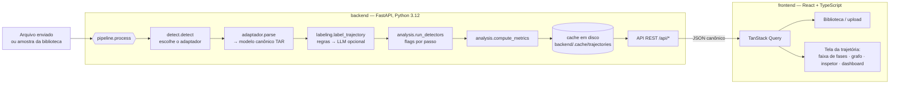

# Arquitetura

Como o trajviz transforma um log bruto em visualização. Termos no [glossário](GLOSSARIO.md); as regras de rotulação e os detectores têm doc próprio ([ROTULACAO_E_DETECTORES.md](ROTULACAO_E_DETECTORES.md)); os formatos de entrada estão em [formats.md](formats.md).

## 1. Visão geral

Princípios:

- **O front só consome o JSON canônico.** Não há parsing, rotulação nem cálculo de métrica no front; até o "passo relacionado" de uma flag (`flag_refs`) e as contagens por terço vêm prontos da API ([decisions.md](decisions.md#frontend)).
- **`backend/app/schema.py` é o contrato.** Mudou o schema → regenerar `docs/openapi.json` e os tipos TS (`cd frontend && npm run gen:api`).
- **Sem banco de dados.** Cache em disco, indexado pelo hash do conteúdo do arquivo.
- **O LLM é opcional.** Sem chave (ou sem pedido explícito no upload) o app funciona só com regras.

## 2. Backend (`backend/app/`)

| módulo | responsabilidade |
|---|---|
| `schema.py` | Modelo canônico TAR (Pydantic v2). |
| `adapters/detect.py` | `load` (arquivo → objeto: JSON, `.jsonl`, Parquet em lotes, `.log`/`.txt`, diretório, `.tar.zst`), `detect` (adaptador de maior confiança, mínimo 0,3), `parse_any`. |
| `adapters/base.py` | Utilidades comuns: normalização de nomes de ferramenta (`TOOL_MAP`), exit code no texto, truncamento, erros `UnknownFormat` e `UnsupportedArtifact`. |
| `adapters/<formato>.py` | Um módulo por formato: `NAME`, `can_parse(obj) -> float`, `parse(source) -> Trajectory`. Lista em [formats.md](formats.md) e no [README](../README.md#formatos-suportados). |
| `adapters/codetracebench.py` | Extração segura do `.tar.zst`, escolha do agente pelos nomes dos membros e montagem do `GroundTruth` a partir do manifest. |
| `labeling/taxonomy.py` | Categorias, fases, descrições (reusadas no prompt do LLM), precedência. |
| `labeling/rules.py` | Camada 1 (nome da ferramenta) e orquestração da camada 2. |
| `labeling/bash_parser.py` | Camada 2: comando de shell (bashlex, com fallback shlex/regex), regras de `python`, arquivos tocados. |
| `labeling/llm.py` | Camada 3: Haiku 5.5 em lotes, com cache e trava de orçamento. Único lugar que fala com a API da Anthropic. |
| `analysis/detectors.py` | Os sete detectores (flags) e `detect_ark`. |
| `analysis/metrics.py` | `compute_metrics` (modelo `Metrics`, exposto no OpenAPI). |
| `pipeline.py` | `process(...)`: limites, detecção, conversão, rotulação, detectores, métricas, avisos, cache; `content_id`, `PIPELINE_VERSION`. |
| `library.py` | Índice das amostras de `data/samples/` (SWE-rebench, SWE-smith, CodeTraceBench, Ark). |
| `config.py` | Variáveis de ambiente (`backend/.env` via python-dotenv; a chave nunca é impressa). |
| `main.py` | Endpoints FastAPI, CORS, corte das observações para a resposta. |

Scripts de pesquisa ficam em `backend/scripts/` (exploração, download, relatórios, avaliação, figuras); cada resultado em `results/` diz qual script o gera ([results/RESULTS.md](../results/RESULTS.md)).

## 3. Frontend (`frontend/src/`)

Vite + React + TypeScript strict, Tailwind v4, componentes no estilo shadcn (Radix), React Router, TanStack Query (dados do servidor), Zustand (estado da tela), `@xyflow/react` (grafo), Recharts (dashboard), prism-react-renderer (código), html-to-image (exportar PNG).

| pasta / arquivo | responsabilidade |
|---|---|
| `api/client.ts`, `api/hooks.ts`, `api/schema.d.ts` | Cliente HTTP (`VITE_API_URL`), hooks do TanStack Query e tipos gerados do OpenAPI. |
| `pages/Library.tsx` | Biblioteca (filtros, busca), upload por arrastar ou escolher, estado de erro "API indisponível". |
| `pages/Trajectory.tsx` | Tela `/t/:id`: cabeçalho, faixa de fases, abas Grafo/Dashboard, inspetor. |
| `components/PhaseStrip.tsx` | Faixa de fases. |
| `components/graph/` | Grafo em serpentina, nós, modo compacto, filtros, minimapa. |
| `components/Inspector.tsx` | Inspetor do passo (rótulo corrigível, flags com link para o passo relacionado, pensamento, ação, observação, arquivos). |
| `components/dashboard/` | Cartões do dashboard; cada problema leva ao passo. |
| `store/ui.ts` | Estado da tela (passo, aba, filtros, intervalo, modo compacto) espelhado na URL (`?step=42&view=graph&filter=error`). |
| `theme/categories.ts` | Paleta fixa por categoria (Okabe-Ito, segura para daltonismo; contraste testado). |
| `lib/` | Utilidades de passos, grafo (layout) e exportação. |

## 4. Modelo canônico TAR (`backend/app/schema.py`)

### `Trajectory`

| campo | significado |
|---|---|
| `id` | Id da fonte (ou hash, quando a fonte não traz). O id **público** da API é outro: o `content_id` (§6). |
| `source_format` | Nome do adaptador que converteu (`openhands_chat`, `ark_trace`…). |
| `agent`, `model` | Agente e modelo (da fonte, do manifest, do `.meta.json` do Ark ou "desconhecido"). |
| `task_id`, `repo`, `problem_statement` | Tarefa, repositório e enunciado. |
| `resolved` | Desfecho da fonte (`null` se ausente). |
| `resolved_validated` | `false` quando o desfecho não é confiável (SWE-smith). |
| `exit_status` | Status de término da fonte (ex.: `submit`, `max_iterations_reached`). |
| `patch` | Patch final, quando confiável. |
| `steps[]` | Passos, em ordem canônica. |
| `ground_truth` | Gabarito do CodeTraceBench (§ `GroundTruth`). |
| `meta` | Livre: dados por formato (`meta.ark`, `meta.loops`, `meta.protocol_events`…). |

### `Step`

| campo | significado |
|---|---|
| `idx` | Posição 0-based (contínua). |
| `native_id` | Id original (tool_call, evento, episódio, `[response N]`). |
| `thought`, `thought_source` | Pensamento e de onde veio (`content`, `think_tool`, `field`, `analysis_plan`). |
| `action` | A ação (§ `Action`). |
| `observation` | O resultado (§ `Observation`); `null` = sem resultado (ação final, trajetória cortada, saída não registrada pelo Ark). |
| `category`, `subcategory`, `summary` | Rótulo da taxonomia, detalhe e o trecho do comando que o definiu. |
| `label_source`, `confidence` | Origem e confiança do rótulo. |
| `flags`, `flag_details`, `flag_refs` | Flags dos detectores, motivo curto de cada uma e passo relacionado. |
| `files[]` | Arquivos tocados: `{path, mode: read\|edit\|run, created}`. |

### `Action` e `Observation`

| campo | significado |
|---|---|
| `Action.tool` | Ferramenta normalizada (`bash`, `editor`, `think`, `submit`, `task_tracker`, `message`, `keys`, `ipython`, `swe_cmd`, `other`; desconhecidas mantêm o nome nativo, ex. `read_file` do Ark). |
| `Action.tool_native` | Nome original da ferramenta. |
| `Action.command` | Comando de shell, subcomando do editor ou nome do comando legado. |
| `Action.args`, `Action.raw` | Argumentos estruturados e texto original da ação. |
| `Observation.content` | Texto da saída. |
| `Observation.exit_code`, `is_error` | Código de saída (quando a fonte traz) e erro explícito. |
| `Observation.chars`, `truncated`, `content_cut` | Tamanho original; corte feito pela própria ferramenta; corte feito pela API na resposta. |

### `GroundTruth` (só CodeTraceBench)

| campo | significado |
|---|---|
| `stages[]` | Estágios (`stage_id`, passo inicial e final). |
| `annotations[]` | Por estágio: `incorrect_step_ids`, `unuseful_step_ids`, `steps[]` (`AnnotatedStep`). |
| `AnnotatedStep.resolved_idx`, `resolved_via` | Passo canônico alinhado e como: `action_ref` / `rule` (confirmados) ou `hypothesis`. |
| `step_ref_kind`, `ref_rule_confirmed` | Unidade do `step_id` naquele agente e se a regra é confirmada. |
| `manifest_step_count` | `step_count` do manifest (pode diferir dos passos extraídos; [formats.md §4.6](formats.md)). |

## 5. API

OpenAPI completo em [`docs/openapi.json`](openapi.json) (Swagger em `/docs` com a API no ar).

| método e rota | o que faz |
|---|---|
| `POST /api/trajectories` | Upload multipart: `file`, `format?` (força um adaptador), `row?` (linha do Parquet/`.jsonl`), `use_llm?` (padrão falso). Aceita `.json`, `.jsonl`, `.traj`, `.log`, `.txt`, `.parquet`, `.tar.zst`, `.zip`. → `{id, format_detected, confidence, n_steps, warnings}` |
| `GET /api/trajectories/{id}` | Trajetória canônica + avisos; observações cortadas em 2.000 caracteres (`chars` = tamanho original, `content_cut`). |
| `GET /api/trajectories/{id}/steps/{idx}` | Um passo com a observação completa. |
| `GET /api/trajectories/{id}/metrics` | Métricas do dashboard. |
| `PATCH /api/trajectories/{id}/steps/{idx}` | Corrige a categoria (`label_source="user"`), recalcula detectores e métricas e grava uma linha em `results/gold/corrections.jsonl`. |
| `GET /api/library?dataset=&agent=&resolved=&q=` | Lista as amostras. |
| `POST /api/library/{sample_id}/open` | Processa (ou reaproveita do cache) uma amostra e devolve o mesmo formato do upload. |
| `GET /api/taxonomy` | Categorias, fases, rótulos e descrições das flags. |
| `GET /api/health` | `{status, pipeline_version, llm_enabled}`. |

Erros: 422 `{detail: {code, message, top_keys?}}` (`invalid_file`, `unknown_format`, `unsupported_extension`, `unsupported_artifact`, `empty_trajectory`, `invalid_format_hint`, `format_mismatch`), 413 para arquivos acima de 200 MB, 404 para id ou passo inexistente.

Variáveis de ambiente do backend: `ANTHROPIC_API_KEY`, `LABEL_LLM_ENABLED`, `LLM_MODEL` (padrão `claude-haiku-5-5`), `LLM_BUDGET_USD` (padrão 0,50 por execução), `CORS_ORIGINS` (padrão `http://localhost:5173`), `TRAJVIZ_CACHE_DIR`, `TRAJVIZ_RESULTS_DIR`, `TRAJVIZ_SAMPLES_DIR`, `TRAJVIZ_CTB_DIR`. Do frontend: `VITE_API_URL` (padrão `http://localhost:8000`), `VITE_PORT` (padrão 5173). Ver `backend/app/config.py`, `main.py`, `library.py` e `frontend/vite.config.ts`.

## 6. Cache e ids estáveis

- **Id público** = `sha256(conteúdo | row | format_hint)[:16]` (`pipeline.content_id`). Não depende do nome do arquivo, do LLM nem da versão das regras, então links `/t/<id>` e capturas não mudam quando as regras mudam.
- **Arquivo de cache** = `backend/.cache/trajectories/<id>.<versão do pipeline>.<variante>.json` (+ `.meta.json` com o resumo para a biblioteca). A versão do pipeline é o hash do código de `schema.py`, `adapters/`, `labeling/`, `analysis/` e `pipeline.py`; a variante cobre o nome do arquivo e o uso do LLM/modelo.
- **Consequência:** depois de mudar as regras (ou limpar o cache), `GET /api/trajectories/<id>` devolve 404 até a amostra ser reaberta pela biblioteca ou o arquivo ser reenviado; o reprocessamento gera **o mesmo id**. É uma limitação conhecida da demo ([LIMITACOES_E_TRABALHOS_FUTUROS.md](LIMITACOES_E_TRABALHOS_FUTUROS.md)).
- Pré-aquecer o cache da biblioteca: `cd backend && uv run python scripts/warm_cache.py`.

## 7. Segurança no upload

- Limite de 200 MB (413). Arquivos são gravados num diretório temporário apagado ao fim do processamento.
- `.tar.zst`: extração com `filter="data"` e sem arquivos de segredo (`.jwt_secret`, `*.pem`, `*.key`, `.env`, `id_rsa*`, `credentials`…), porque um artefato do CodeTraceBench trazia `.jwt_secret`.
- `.zip`: checagem manual (sem `..`, caminhos absolutos, links simbólicos e segredos).
- Erros de conteúdo viram 422 com código e mensagem; nada do arquivo é executado.
- A chave da API só vem do ambiente/`.env`, com `repr=False`; exceções da API guardam só o nome do tipo.

## 8. Como adicionar um formato novo (exemplo: `ark_trace`)

1. **Entender o formato na fonte.** Para o Ark, a semântica foi confirmada em `src/ark/{traces,agentic_loop,tools}.py` do Ark, sem alterar nada lá. Documente em [formats.md](formats.md) (o Ark está no §11): blocos, unidade do passo, onde estão pensamento, ação, observação e desfecho, o que o formato **não** registra.
2. **Criar o adaptador** em `backend/app/adapters/<nome>.py` com `NAME`, `can_parse(obj) -> float` e `parse(source) -> Trajectory`.
   - `can_parse` deve ser específico (o Ark exige `[request]` no início **e** `[response N]` com `thought:`/`action:`; confiança 0,97) e devolver 0 para os outros formatos.
   - Preencha só o modelo canônico. Se faltar campo, use `Trajectory.meta` (o Ark guarda resultados e avisos em `meta.ark`); mudar `schema.py` exige consultar o Pedro antes ([CLAUDE.md](../CLAUDE.md), "Quando parar e perguntar", item (c)).
3. **Registrar** o módulo em `ADAPTERS` de `adapters/detect.py` e, se a extensão for nova, em `load` (o Ark trouxe `.log`/`.txt`) e em `pipeline.SUFFIXES`.
4. **Rotulação:** se as ferramentas forem novas, acrescente regras de camada 1 em `labeling/rules.py` (o Ark mapeia `list_files`→`explore`, `read_file`→`read`, `find_text`→`search`, `run_tests`→`test`, `edit_file`→`edit`, `finish`→`submit`). Nada de lógica no front.
5. **Detectores:** se o formato informa o resultado explicitamente, prefira-o à inferência por texto (o Ark usa `detect_ark`).
6. **Testes com fixture real** em `backend/tests/fixtures/` e `backend/tests/test_<nome>.py` (o Ark tem 5 fixtures e um teste de integração que abre todos os traces).
7. **Interface:** aceitar a extensão no upload (`pages/Library.tsx`) e, se for o caso, a biblioteca (`library.py`).
8. **Documentar:** [formats.md](formats.md), tabela de formatos do [README](../README.md#formatos-suportados), uma linha em [decisions.md](decisions.md) e o estado em [CLAUDE.md](../CLAUDE.md).
